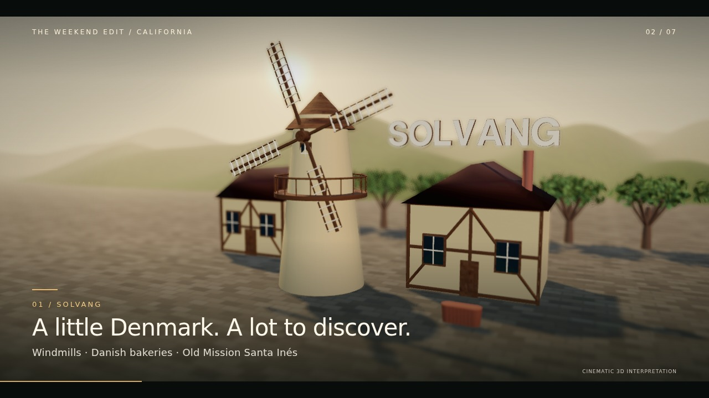

# Santa Ynez & Beyond — 3D visitor film

[Download the rebuilt 60-second 3D video](https://github.com/thebenwalther/playground/raw/refs/heads/santa-ynez-video/videos/santa-ynez-cinematic-3d.mp4)

The reworked film uses full-screen modeled scenes, perspective camera moves, extruded titles, textured materials, environment reflections, depth of field, and animated windmill sails and sailboat movement. It includes music and visitor recommendations for Santa Ynez, Ballard, Solvang, Los Olivos, Buellton, and Lake Cachuma.

The scenes are artistic interpretations of the area's architecture and experiences, not exact landmark reconstructions or geographic surveys. The downloadable MP4 is 1280 × 720, with 24 fps playback and H.264/AAC encoding.

See [the visitor guide](Visitor-Guide.md) for a two-day itinerary and planning links. Confirm current opening hours, reservations, and access before traveling.

The earlier map-based version remains archived as `santa-ynez.mp4`.
